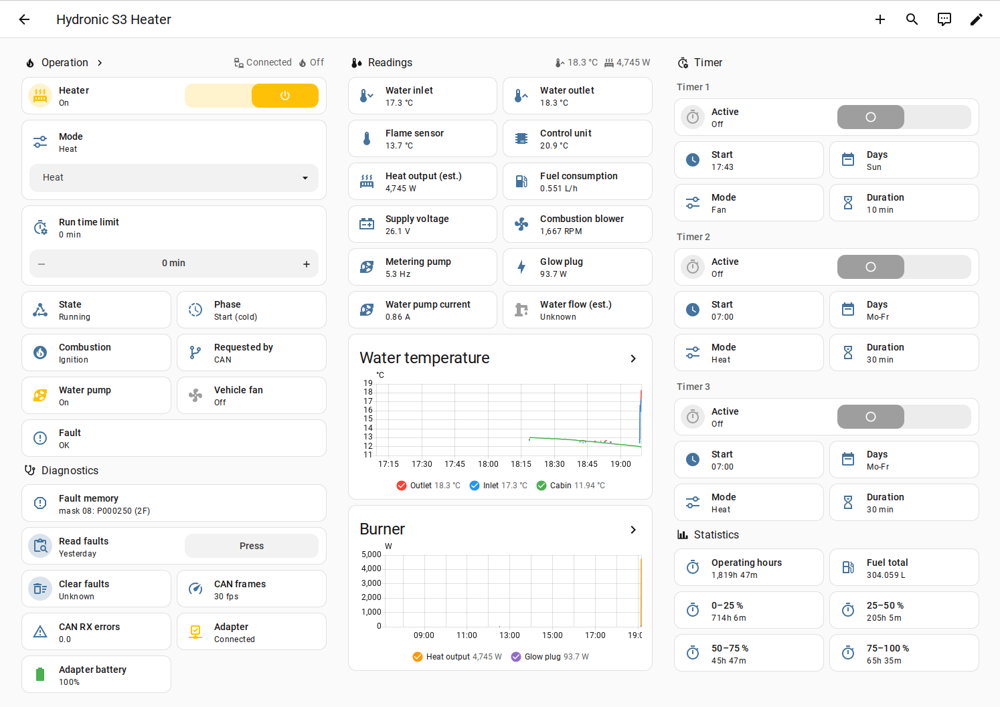

# ESPHome for the Eberspächer Hydronic S3

Read **everything** an Eberspächer Hydronic S3 coolant heater knows over CAN, and start/stop it
without the original EasyStart control unit: temperatures, burner power, fuel consumption, operating
phase, flame, glow plug, blower, supply voltage, operating hours, fault codes. Shown on a small LCD,
in a web UI and in Home Assistant.

Built and tested on a **Hydronic S3 D6L Commercial 24 V** (25.2745.01.5001) in a van, with an
M5Stack Fire and its COMMU (MCP2515) CAN module.

<p align="center">
  <br>
  <em>Heater page on the 320×240 LCD (rendered with the SDL preview, demo values)</em>
</p>

## What it does

- **Live data** from the heater's broadcast frames and from UDS diagnostics (ReadDataByIdentifier),
  polled only while the heater is active, so the bus and the heater can go to sleep:
  - outlet / inlet temperature, ΔT, flame sensor temperature
  - heating power (estimated from fuel × datasheet heat output), fuel consumption, total fuel burnt
  - coolant flow (estimated from power and ΔT while burning; coolant heat capacity set for a ~50 % glycol
    premix such as Alde Premixed G13, `COOLANT_J_PER_L_K`)
  - operating phase (check, cold/warm start, heating, control pause, run-down, shutdown, blocked), start progress,
    combustion state (no fuel / ignition / burning), flame, glow plug power
  - blower speed, metering pump rate, supply voltage, control unit temperature
  - operating hours per power band, control pause, altitude mode
  - hardware/software version, part and serial number
  - fault codes (DTC read-out with status; clearing needs the heater's unlock key, see below)
- **Control**: start and stop, indefinitely or with a watchdog, through a switch, REST or the
  ESPHome API. The component takes the EasyStart's role on the bus (wake-up, command set,
  keep-alive) and retries the start when the heater holds it.
- **Robust on the bus**: listen-only while an EasyStart is present, acknowledging otherwise,
  sleep/wake handling, values go to "unknown" when the heater is away, CAN error counters.



<p align="center"><em>Home Assistant dashboard during a cold start
  (<a href="docs/ha-dashboard.yaml"><code>docs/ha-dashboard.yaml</code></a>)</em></p>

## Scope

In scope: reading the heater's data, and controlling its operation. Diagnosing faults and improving understanding.
Out of scope: changing the control unit's parameters or variant coding.

This project writes nothing to the heater's coding and documents no way to do so. These settings determine the
safety-relevant behaviour of a combustion heater and this software is not intended for this type of work.

## Status

This is a working research project, not a product. Read-out is solid; start/stop works with the
EasyStart **disconnected** (two controllers on one heater are not supported by the heater). What is
still open is listed in [`docs/protocol.md`](docs/protocol.md#open).

> **Safety.** This controls a combustion heater. Keep an independent way to cut its power, never
> leave experiments unattended, and expect fault codes while experimenting. Use at your own risk.

## Hardware

| Part | Notes | Links |
|---|---|---|
| M5Stack Fire v2.7 | ESP32 (4 MB PSRAM, unused), 320×240 LCD, M5GO battery base. The research rig; for an integration any ESP32 with a CAN transceiver on its own controller (TWAI) works, see `esphome/example-twai.yaml` | [docs](https://docs.m5stack.com/en/core/fire_v2.7), [shop](https://shop.m5stack.com/products/m5stack-fire-iot-development-kit-psram-v2-7) |
| M5Stack COMMU | MCP2515 CAN controller + transceiver, 8 MHz crystal, stacks under the Fire (M-Bus) | [docs](https://docs.m5stack.com/en/module/commu), [shop](https://shop.m5stack.com/products/commu-module), [schematic](https://static-cdn.m5stack.com/resource/docs/products/module/commu/commu_sch_01.webp) |
| CAN tap | heater CAN H/L (+ GND), 500 kbit/s, 11-bit IDs, at the EasyStart connector or the diagnostic plug | |
| Supply | 24 V vehicle → buck converter rated ≥ 36 V input + TVS diode → 5 V | |

<p align="center">
  <a href="https://docs.m5stack.com/en/core/fire_v2.7"></a>
  <a href="https://docs.m5stack.com/en/module/commu"></a><br>
  <em>M5Stack Fire v2.7 and COMMU (images: M5Stack)</em>
</p>

### Wiring

```
24 V vehicle ──┬──────────────────────────────── Hydronic S3 (power, own fuse)
               └── buck ≥ 36 V in + TVS ── 5 V ── M5Stack Fire
                                                  │ M-Bus (stacked)
                                                  COMMU (MCP2515, 8 MHz)
                                                  │ CAN H, CAN L, GND
Hydronic S3 CAN ── EasyStart connector (EasyStart unplugged for control) or diagnostic plug
```

| Fire GPIO | Function |
|---|---|
| 18 / 23 / 19 | SPI CLK / MOSI / MISO, on SPI3 (IOMUX), shared with the LCD (CS 14, DC 27) and the SD slot (CS 4, held high) |
| 12 | COMMU CAN CS (strapping pin, boots fine) |
| 15 | COMMU CAN INT |

- The heater bus is already terminated; tap it mid-bus without adding a second 120 Ω (check the COMMU's
  termination setting).
- CAN H/L wire colours at the EasyStart connector are not labelled; if the bus stays silent, swap them.
- Leave the Fire's SD slot empty: a card answers SPI traffic and corrupts MCP2515 reads.

### Test setup

The Fire with the COMMU stacked underneath, tapped into the heater CAN at the EasyStart connector of a
Hydronic S3 D6L Commercial 24 V in a van. The EasyStart is disconnected for control tests.

Hard-won details (see `CLAUDE.md`): the shared SPI bus must run on SPI3 (IOMUX pins) for clean
8 MHz MCP2515 reads; leave the SD slot empty; the CAN reader runs in IRAM so flash writes and the
display never cost frames.

## Layout

| Path | Content |
|---|---|
| `components/hydronic_s3/` | the heater component: decoding, polling state machine, control |
| `components/mcp2515_irq/` | interrupt-driven MCP2515 driver (fork of the ESPHome core driver) |
| `components/mipi_spi/` | display driver fork that shares the SPI bus fairly with the CAN reader |
| `esphome/hydronic-s3.yaml` | device configuration |
| `esphome/ui/heater-ui.yaml` | LVGL user interface, shared with the SDL preview |
| `esphome/timers.yaml`, `esphome/timers/` | optional heater timers (three slots, SNTP clock) |
| `esphome/hydronic-s3-sdl.yaml` | UI preview on the PC (SDL), demo values |
| `esphome/example-twai.yaml` | minimal integration on the ESP32's own CAN controller (TWAI), no MCP2515 |
| `docs/protocol.md` | protocol reference: frames, commands, configuration burst, phases, UDS, DIDs |
| `docs/research.md` | lab journal: dated experiments and raw captures behind the reference |
| `docs/can-sniffing.md` | how to capture and decode the bus with the research tools |
| `docs/dtc.md` | fault code (DTC) table: meanings, checks, codes seen here |
| `docs/ha-dashboard.yaml` | Home Assistant dashboard view (sections; charts need apexcharts-card) |

## Build and flash

Create `esphome/secrets.yaml` (gitignored) with the keys
`wifi_ssid`, `wifi_password`, `api_key` (`head -c 32 /dev/urandom | base64`) and `ota_password`, then:

```sh
uv venv work/venv && uv pip install -p work/venv/bin/python esphome
cd esphome
../work/venv/bin/esphome run hydronic-s3.yaml
```

UI preview without hardware: `../work/venv/bin/esphome run hydronic-s3-sdl.yaml`.

## Configuration

Minimal `hydronic_s3` setup on any ESP32 CAN bus (complete example: `esphome/example-twai.yaml`;
full device: `esphome/hydronic-s3.yaml`). All entities are optional.

```yaml
external_components:
  - source: github://farnham26/esphome-s3-hydronic-cs
    components: [hydronic_s3]

canbus:
  - platform: esp32_can          # or mcp2515 (the Fire uses the mcp2515_irq fork)
    id: heater_can
    tx_pin: GPIO4                # your transceiver pins
    rx_pin: GPIO5
    can_id: 0x7A0                # unused: the component sends with explicit IDs
    bit_rate: 500KBPS

hydronic_s3:
  id: heater
  canbus_id: heater_can
  time_id: sntp_time             # optional: send our clock to the heater (needs a time: source)
  research: false                # optional: ID table, change log, wake trace in the log
  observer: false                # optional: diagnosis only, another unit is the control unit
  poll_interval: 5s              # optional: sweep of the polled values; stops while the heater sleeps
  on_new_fault_code:             # optional, see "Controlling the heater"
    - logger.log: {format: "new fault code %s", args: [code.c_str()]}

sensor:
  - platform: hydronic_s3
    outlet_temperature: {name: "Outlet Temperature"}       # status frame, 100 ms
    inlet_temperature: {name: "Inlet Temperature"}          # the rest: polled
    # flame_sensor_temperature, supply_voltage, blower_speed, glow_plug_power, metering_pump_rate,
    # water_pump_current, fuel_pump_current, water_pump_power, operating_phase, start_step,
    # combustion_state, fuel_consumption, heating_power, water_flow, fuel_total, control_unit_temperature,
    # hours_total, hours_power_0_25, hours_power_25_50, hours_power_50_75, hours_power_75_100,
    # hours_pause, hours_altitude, state_code

binary_sensor:
  - platform: hydronic_s3
    connected: {name: "Heater Connected"}
    # flame, vehicle_fan, request, on_request

text_sensor:
  - platform: hydronic_s3
    state: {name: "Heater State"}
    # fault, fault_codes, event, operating_phase_text, combustion_text, request_source,
    # hardware_version, software_version, part_number, serial_number, diag_response

switch:
  - platform: hydronic_s3
    type: run                                 # start/stop; reads back refusals and stops by the component
    name: "Heater Run"
  # type: polling (on at boot; without it, polling always runs)

select:
  - platform: hydronic_s3
    mode: {name: "Heater Mode"}               # Heat / Residual heat / Fan, restored; "S+" while S+ runs

number:
  - platform: hydronic_s3
    run_watchdog: {name: "Heater Run Watchdog"}   # minutes, restored, 0 = none

button:
  - platform: hydronic_s3
    read_fault_codes: {name: "Read Fault Codes"}
    # clear_fault_codes (needs the security provider, below)
```

Action `hydronic_s3.command`: `run` (start/stop), optional `mode` (`HEAT` | `FAN` | `RESIDUAL`) and
`lease` (watchdog, e.g. `5min`, `0s` = none); all templatable. Conditions `hydronic_s3.commanding` (we
command "on") and `hydronic_s3.burner_on` (starting or heating, polled). Full example with a regulator in
plain YAML: `esphome/example-twai.yaml`.

## Controlling the heater

All controls are in the web UI group **Heater Control**.

| Action | REST (web server) | ESPHome API |
|---|---|---|
| start | `POST /switch/Heater%20Run/turn_on` | `heater_start` |
| stop | `POST /switch/Heater%20Run/turn_off` | `heater_stop` |
| state | `GET /switch/Heater%20Run` | entity `switch.heater_run` |

- **Heater Mode**: what `Heater Run` starts, as the EasyStart's modes — **Heat** (burner), **Residual heat**
  (water pump + vehicle fan, e.g. to spread an electrically heated reservoir through the vehicle) and **Fan** (vehicle fan
  only). A mode change while running takes effect with the next command frame.
- **Heater Run Watchdog** (minutes): `0` = run until stopped (default). Above 0 the heater is stopped
  unless `turn_on` is repeated within that time, for controllers that should fail safe.
- **Timers** (web UI group **Timers**, package `esphome/timers.yaml`, optional): three slots like the
  EasyStart's — days (Mo-Fr, Sa-Su, Mo-Su or a single day), start time, mode, duration, active. Set
  from HA or the web UI, run on the device (no HA needed once the clock has synced via SNTP). The
  heater itself has no timer; the EasyStart runs its own.
- **Clock**: with `time_id:` on `hydronic_s3` the heater gets our time (`10A`, as the EasyStart's
  time setting).
- **Triggers** on `hydronic_s3` (phase-based ones lag up to one `poll_interval`):
  - **`on_run_ended:`** (variable `reason`, for logging only) a run started with `run: true` ended other
    than by `run: false`; never during a start or a start retry. Covers:
    - end of a burn at the heater's coolant limit (≈83 °C, pause straight from heating), also with fault
      flags set: the run stays on and the heater restarts at ≈71 °C unless released. Once per burn.
    - the heater ended the run itself (blocked `C8`, run-down `1E`, residual heat refused/ended, off):
      the component releases the run.
    - start refused after all retries, another control unit on the bus, run watchdog: the run is off.

    A regulator releases its request here (`run: false`) without looking at `reason`. Paths seen on the
    heater so far: residual heat refused; the others are unverified.
  - **`on_new_fault_code:`** (variable `code`, e.g. `"P000250"`) a stored fault code that was not in the
    memory before (read on connect and when the fault flags rise). After a clear, a recurrence fires again.
  - `on_event:` (every transition, names unstable) needs `research: true`.
- **Stopping from a regulator** (avoid wasted burner cycles; each start costs glow energy, a fuel
  stroke and soot):
  1. Turn off at `on_run_ended`, or whenever `hydronic_s3.burner_on` is false: the loop is fully charged
     and the burner is out, so the stop costs nothing and prevents the heater's own restart (~70 °C).
     See `esphome/example-twai.yaml`.
  2. A stop during a start (glow/fuel phase) is deferred by the component until the start is over;
     the run watchdog too.
  3. Turning on again during the run-down restarts a hot burner (extra purge, phase `0D`); the component
     does not prevent it yet.
- A start hold (fault flag `0x40`) is retried up to three times, then the switch turns off.
- **S+ wins**: `run: true` is refused (log warning only) while the heater runs on S+; release S+ first.
  A watchdog stops a run, it never restarts a stopped heater.
- **Observer** (`observer: true`, runtime switch **Observer**): a second unit for display and diagnosis
  next to the one that controls the heater (one control unit per bus). It decodes everything, including
  the other unit's UDS answers, and stays a UDS tester (scans, requests, fault codes), but sends no
  control frames: `Heater Run` is refused. Its requests wait for another tester's pending answer; `11`,
  `28`, `85` and `31 01` are refused while the heater is active.
- On stop the component keeps talking to the heater through its run-down (the heater raises
  P000307 "CAN communication error" if its controller falls silent).
- **Read Fault Codes** / **Clear Fault Codes** (buttons): the error memory as the EasyStart's workshop
  menu shows and deletes it (code list: [`docs/dtc.md`](docs/dtc.md)). Clearing needs a SecurityAccess
  key that is not in this repo; register it with `set_security_provider()` from a local config (below).
  Without it, clearing fails with a message; everything else works.

  Local, untracked overlay (e.g. `esphome/my-heater.yaml`, flash this instead of `hydronic-s3.yaml`):

  ```yaml
  # Pull in the public device config unchanged.
  packages:
    base: !include hydronic-s3.yaml

  esphome:
    on_boot:                      # appended to the base config's on_boot list
      - priority: -100            # after the component is set up
        then:
          - lambda: |-
              // Called by clear_dtc() with the heater's SecurityAccess seed (27 65 reply).
              // Write the matching key for 27 66 and return true; false aborts the clear.
              id(heater).set_security_provider([](const uint8_t seed[4], uint8_t key_out[4]) -> bool {
                static const uint8_t kSeed[4] = {0xAA, 0xBB, 0xCC, 0xDD};  // placeholder: your heater's seed
                static const uint8_t kKey[4] = {0x00, 0x00, 0x00, 0x00};   // placeholder: matching key
                if (memcmp(seed, kSeed, 4) != 0)
                  return false;  // unknown seed
                memcpy(key_out, kKey, 4);
                return true;
              });
  ```

  Seed and key can be read off the bus while the EasyStart's workshop menu clears the error memory.

## Non-stock water pump: start holds (P000252 / P000250)

If you drive a **different coolant pump** from the heater's pump output — especially through a **DC/DC
converter** (e.g. to protect a lower-voltage pump) — the heater may refuse starts at random:

- **Symptom:** after a start request the heater stays idle; `2C4` byte 2 carries flag `0x40`, the phase reads
  `0xC8` ("Blocked" in this firmware). Switching off and on again 1–3 times usually gets it going. It happens with
  S+, the EasyStart and CAN starts alike, warm or cold.
- **Diagnosis:** each hold stores **P000252** ("water pump: short to +Ub or transistor error"); its occurrence
  counter (`19 06 00 02 52 FF`) goes up by exactly one per hold. Our unit had ~110 of them.
- **Cause (most likely):** the heater checks its pump output while it is switched off and expects the line to
  fall. A converter's input capacitance keeps the line near the supply voltage, which the heater reads as a short
  to +Ub. A stock (BLDC) pump does not do that.
- **Fix that works for us:**

  ```
   heater                     D1 Schottky            DC/DC                 pump
   pump out ──┬──[ NTC ]──────►|───────────────[ IN+       OUT+ ]────────(+)
              │  (optional,  anode  cathode      (C_in inside)             M
             ┌┴┐  inrush)                                                  │
         R1  │ │ 1–1.2 kΩ, ≥ 1 W                                           │
             └┬┘ heater side!                                              │
   GND ───────┴────────────────────────────────[ IN−       OUT− ]────────(−)
  ```

  1. A **Schottky diode in series** (anode at the heater's pump output, cathode at the converter), ≥ 60 V, rated
     well above the pump current (we use an MBR3060PT). It stops the back-feed: P000252 has not counted since.
  2. A **bleeder resistor on the heater side** of the diode (anode → ground), ~1–1.2 kΩ, ≥ 1 W. Without it, or
     with the resistor on the converter side, the heater sees no load when off and reports **P000250**
     ("open circuit") instead.
  3. Mind the **inrush** into the converter's input capacitor: a series resistor costs a lot of power with a
     constant-power load (max. transferable power is Ub²/4R); an NTC inrush limiter is the better choice if the
     heater reports overcurrent at switch-on. Without either we have seen no overcurrent code so far.
- **Firmware:** `Heater Run` retries a held start up to three times (5 s off in between) and reports the hold.

Result here: before the fix 3 of 4 S+ starts held; after it 6 of 6 started and the fault memory stayed empty.
This is one installation and a limited number of starts; check your own fault memory before and after.

## How it works (short)

- The heater broadcasts status (`2C4`: state, outlet temperature, fault flags; `625`, `2C5`, `2C6`).
  Everything else comes from UDS on `0x7A0` → `0x73C`: `22 FDxx` live data, `19 02/06` fault memory.
- The controller wakes the sleeping bus with its keep-alive (`60D`) and commands with `054` every 200 ms;
  the run time is kept in the controller, not in the heater. The component takes that role.
- Polling keeps the heater awake, so the component polls only while the heater is active.

Reference: [`docs/protocol.md`](docs/protocol.md); evidence and raw captures: [`docs/research.md`](docs/research.md);
capturing it yourself: [`docs/can-sniffing.md`](docs/can-sniffing.md).

## License

GPL-3.0, see [`LICENSE`](LICENSE). The `mcp2515_irq` and `mipi_spi` components are forks of
ESPHome components.

Not affiliated with or endorsed by Eberspächer. Product names are trademarks of their owners.
