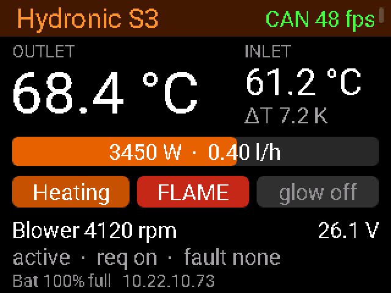
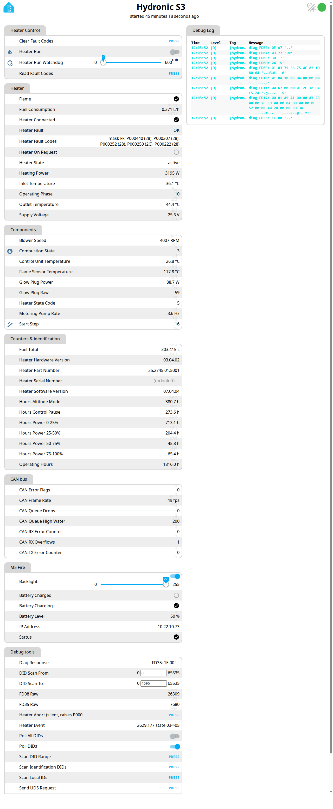

# ESPHome for the Eberspächer Hydronic S3

Read **everything** an Eberspächer Hydronic S3 coolant heater knows over CAN, and start/stop it
without the original EasyStart control unit: temperatures, burner power, fuel consumption, operating
phase, flame, glow plug, blower, supply voltage, operating hours, fault codes. Shown on a small LCD,
in a web UI and in Home Assistant.

Built and tested on a **Hydronic S3 D6L Commercial 24 V** (25.2745.01.5001) in a van, with an
M5Stack Fire and its COMMU (MCP2515) CAN module.

<p align="center">
  <br>
  <em>Heater page on the 320×240 LCD (rendered with the SDL preview, demo values)</em>
</p>

## What it does

- **Live data** from the heater's broadcast frames and from UDS diagnostics (ReadDataByIdentifier),
  polled only while the heater is active, so the bus and the heater can go to sleep:
  - outlet / inlet temperature, ΔT, flame sensor temperature
  - heating power (estimated from fuel × datasheet heat output), fuel consumption, total fuel burnt
  - coolant flow (estimated from power and ΔT while burning; coolant heat capacity set for a ~50 % glycol
    premix such as Alde Premixed G13, `COOLANT_J_PER_L_K`)
  - operating phase (check, cold/warm start, heating, control pause, run-down, shutdown, blocked), start progress,
    combustion state (pre-glow / fuel / flame), flame, glow plug power
  - blower speed, metering pump rate, supply voltage, control unit temperature
  - operating hours per power band, control pause, altitude mode
  - hardware/software version, part and serial number
  - fault codes (DTC read-out with status)
- **Control**: start and stop, indefinitely or with a watchdog, through a switch, REST or the
  ESPHome API. The component takes the EasyStart's role on the bus (wake-up, command set,
  keep-alive) and retries the start when the heater holds it.
- **Robust on the bus**: listen-only while an EasyStart is present, acknowledging otherwise,
  sleep/wake handling, values go to "unknown" when the heater is away, CAN error counters.



## Status

This is a working research project, not a product. Read-out is solid; start/stop works with the
EasyStart **disconnected** (two controllers on one heater are not supported by the heater). What is
still open is listed in [`docs/research.md`](docs/research.md).

> **Safety.** This controls a combustion heater. Keep an independent way to cut its power, never
> leave experiments unattended, and expect fault codes while experimenting. Use at your own risk.

## Hardware

| Part | Notes |
|---|---|
| M5Stack Fire v2.7 | ESP32, LCD, battery (the research rig). For integration, any ESP32 with a CAN transceiver on TWAI works, see `esphome/example-twai.yaml` |
| M5Stack COMMU | MCP2515, 8 MHz crystal, CS GPIO12, INT GPIO15 |
| CAN tap | heater CAN H/L, 500 kbit/s, 11-bit IDs (EasyStart connector or diagnostic plug) |
| Supply | 24 V vehicle → buck converter with ≥ 36 V input rating + TVS → 5 V |

Hard-won details (see `CLAUDE.md`): the shared SPI bus must run on SPI3 (IOMUX pins) for clean
8 MHz MCP2515 reads; leave the SD slot empty; the CAN reader runs in IRAM so flash writes and the
display never cost frames.

## Layout

| Path | Content |
|---|---|
| `components/hydronic_s3/` | the heater component: decoding, polling state machine, control |
| `components/mcp2515_irq/` | interrupt-driven MCP2515 driver (fork of the ESPHome core driver) |
| `components/mipi_spi/` | display driver fork that shares the SPI bus fairly with the CAN reader |
| `esphome/hydronic-s3.yaml` | device configuration |
| `esphome/ui/heater-ui.yaml` | LVGL user interface, shared with the SDL preview |
| `esphome/hydronic-s3-sdl.yaml` | UI preview on the PC (SDL), demo values |
| `esphome/example-twai.yaml` | minimal integration on the ESP32's own CAN controller (TWAI), no MCP2515 |
| `docs/research.md` | protocol research: frames, DIDs, phases, wake-up, start hold analysis |

## Build and flash

Create `esphome/secrets.yaml` (gitignored) with the keys
`wifi_ssid`, `wifi_password`, `api_key` (`head -c 32 /dev/urandom | base64`) and `ota_password`, then:

```sh
uv venv work/venv && uv pip install -p work/venv/bin/python esphome
cd esphome
../work/venv/bin/esphome run hydronic-s3.yaml
```

UI preview without hardware: `../work/venv/bin/esphome run hydronic-s3-sdl.yaml`.

## Controlling the heater

All controls are in the web UI group **Heater Control**.

| Action | REST (web server) | ESPHome API |
|---|---|---|
| start | `POST /switch/Heater%20Run/turn_on` | `heater_start` |
| stop | `POST /switch/Heater%20Run/turn_off` | `heater_stop` |
| state | `GET /switch/Heater%20Run` | entity `switch.heater_run` |

- **Heater Mode**: what `Heater Run` starts, as the EasyStart's modes — **Heat** (burner), **Residual heat**
  (water pump + vehicle fan, e.g. to spread an electrically heated reservoir through the vehicle) and **Fan** (vehicle fan
  only). A mode change while running takes effect with the next command frame.
- **Heater Run Watchdog** (minutes): `0` = run until stopped (default). Above 0 the heater is stopped
  unless `turn_on` is repeated within that time, for controllers that should fail safe.
- A start hold (fault flag `0x40`) is retried up to three times, then the switch turns off.
- On stop the component keeps talking to the heater through its run-down (the heater raises
  P000307 "CAN communication error" if its controller falls silent).

## Non-stock water pump: start holds (P000252 / P000250)

If you drive a **different coolant pump** from the heater's pump output — especially through a **DC/DC
converter** (e.g. to protect a lower-voltage pump) — the heater may refuse starts at random:

- **Symptom:** after a start request the heater stays idle; `2C4` byte 2 carries flag `0x40`, the phase reads
  `0xC8` ("Blocked" in this firmware). Switching off and on again 1–3 times usually gets it going. It happens with
  S+, the EasyStart and CAN starts alike, warm or cold.
- **Diagnosis:** each hold stores **P000252** ("water pump: short to +Ub or transistor error"); its occurrence
  counter (`19 06 00 02 52 FF`) goes up by exactly one per hold. Our unit had ~110 of them.
- **Cause (most likely):** the heater checks its pump output while it is switched off and expects the line to
  fall. A converter's input capacitance keeps the line near the supply voltage, which the heater reads as a short
  to +Ub. A stock (BLDC) pump does not do that.
- **Fix that works for us:**

  ```
   heater                     D1 Schottky            DC/DC                 pump
   pump out ──┬──[ NTC ]──────►|───────────────[ IN+       OUT+ ]────────(+)
              │  (optional,  anode  cathode      (C_in inside)             M
             ┌┴┐  inrush)                                                  │
         R1  │ │ 1–1.2 kΩ, ≥ 1 W                                           │
             └┬┘ heater side!                                              │
   GND ───────┴────────────────────────────────[ IN−       OUT− ]────────(−)
  ```

  1. A **Schottky diode in series** (anode at the heater's pump output, cathode at the converter), ≥ 60 V, rated
     well above the pump current (we use an MBR3060PT). It stops the back-feed: P000252 has not counted since.
  2. A **bleeder resistor on the heater side** of the diode (anode → ground), ~1–1.2 kΩ, ≥ 1 W. Without it, or
     with the resistor on the converter side, the heater sees no load when off and reports **P000250**
     ("open circuit") instead.
  3. Mind the **inrush** into the converter's input capacitor: a series resistor costs a lot of power with a
     constant-power load (max. transferable power is Ub²/4R); an NTC inrush limiter is the better choice if the
     heater reports overcurrent at switch-on. Without either we have seen no overcurrent code so far.
- **Firmware:** `Heater Run` retries a held start up to three times (5 s off in between) and reports the hold.

Result here: before the fix 3 of 4 S+ starts held; after it 6 of 6 started and the fault memory stayed empty.
This is one installation and a limited number of starts; check your own fault memory before and after.

## How it works (short)

- The heater broadcasts status (`2C4`: state, outlet temperature, fault flags; `625`, `2C5`, `2C6`).
  Everything else comes from UDS on `0x7A0` → `0x73C`: `22 FDxx` live data, `19 02/06` fault memory.
- The EasyStart wakes the sleeping bus by sending its keep-alive (`60D`) until the heater acknowledges;
  it commands with `054` (`01 01` on, `00 00` off) every 200 ms. The run time is kept in the
  EasyStart, not in the heater.
- Polling keeps the heater awake (a ~5 s diagnostic hold), so the component polls only while the
  heater is active and lets it sleep otherwise.

Details, raw captures and open questions: [`docs/research.md`](docs/research.md).

## License

GPL-3.0, see [`LICENSE`](LICENSE). The `mcp2515_irq` and `mipi_spi` components are forks of
ESPHome components.

Not affiliated with or endorsed by Eberspächer. Product names are trademarks of their owners.
